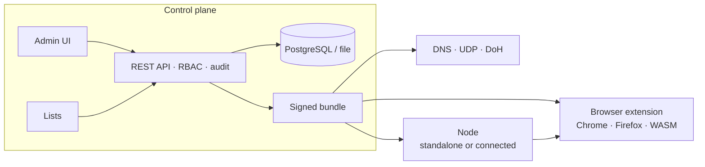

<div align="center">

# Hygieia

**Filtering DNS and browser content blocking from one signed policy.**
Self-hosted, multi-tenant, auditable. Written in Rust.

[](https://github.com/bytehawks-org/hygieia/actions/workflows/ci.yml)
[](https://github.com/bytehawks-org/hygieia/actions/workflows/codeql.yml)
[](https://github.com/bytehawks-org/hygieia/actions/workflows/audit.yml)
[](https://github.com/bytehawks-org/hygieia/actions/workflows/coverage.yml)
[](https://github.com/bytehawks-org/hygieia/releases)
[](LICENSE)
[](https://www.rust-lang.org)
[](https://github.com/bytehawks-org/hygieia/commits)


[Documentation](docs/README.md) ·
[Getting started](docs/guides/getting-started.md) ·
[Architecture](docs/architecture/overview.md) ·
[API](docs/reference/api.md) ·
[Roadmap](docs/ROADMAP.md) · [Changelog](CHANGELOG.md)

</div>

---

Hygieia compiles open-license filter lists and your own rules into **one versioned, ed25519-signed bundle**. The browser extension, the DNS server and the local node all load that same artefact through the same engine, so a rule means the same thing everywhere. A control plane adds multi-tenancy, RBAC, OIDC, and a tamper-evident audit trail.

## Highlights

- **One policy, many enforcement points.** Precedence is fixed: custom allow > custom block > list allow > list block > default.
- **Signed and verifiable.** Clients verify the signature before decoding and refuse rollbacks; the extension pins the key.
- **Runs the way you need it.** A *standalone node* on one PC (no database, no IdP), a *central server* for an organisation (PostgreSQL, OIDC, replicas), or both: nodes in front of a server, caching bundles and surviving outages.
- **DNS is opt-in.** The default install never touches the system resolver. Local DNS filtering and a cloud DNS service (DoH, DoT, DoQ, plain DNS from registered networks; never an open resolver) are options.
- **Multi-tenant by construction.** Single-organisation is the same code path with one tenant. PostgreSQL row-level security enforces isolation; tenant and group derive from the credential, never from request parameters.
- **Auditable.** Per-tenant SHA-256 hash chain, verification endpoint, append-only at the database, secrets never in diffs.
- **Open lists, downloaded at runtime** (HaGeZi, StevenBlack, URLhaus, EasyList/EasyPrivacy, uBlock filters), each with license and attribution; lists are treated as hostile input.
- **Browser content blocking:** network blocking, element hiding and scriptlets for Chrome (MV3) and Firefox (MV3), engine compiled to WASM.
- **Small and fast.** 240k domains: ≈ 1 µs per lookup, +63 MB, signed bundle ≈ 5–8 MB.



## Quick start

Prerequisites: Rust stable, Node.js 22, `curl`, `python3` (PostgreSQL optional).

```bash
git clone https://github.com/bytehawks-org/hygieia && cd hygieia
(cd web && npm ci && npm run build)          # admin UI (static; served by the binaries)
```

**On one PC: the standalone node**

```bash
cargo run -p hygeia-proxy -- run             # UI + API + extension feed on http://127.0.0.1:8470/
cargo run -p hygeia-proxy -- open            # opens the UI already signed in
```

**For an organisation: the central server**

```bash
HYGEIA_ENVIRONMENT=dev cargo run -p hygeia   # http://127.0.0.1:8080/ ; prints a throwaway break-glass token
```

Then connect a browser (`./extension/build.sh`, load `extension/`, enter the URL, an enrolment token and the public key) and see it work:

```bash
scripts/smoke-node.sh      # 19 behaviour checks against the real node binary
scripts/smoke-server.sh    # 46 checks: RBAC, tenants, cloud DNS, query log, metrics, HTTPS, audit, connected node, offline behaviour
```

Step by step: [Getting started](docs/guides/getting-started.md).

## Install

| Target | How | State |
|---|---|---|
| Linux `.deb` + systemd | `packaging/linux/build-deb.sh` or the release asset; `systemctl enable --now hygeia-proxy` | built and installed in a container; unit not run on a live systemd host |
| Linux tarballs | release assets (`hygeia-proxy`, `hygeia-server`) | built by CI |
| Linux RPM | `packaging/linux/hygeia-proxy.spec` | written, **never built** |
| Windows service + tray + setup wizard | release `.msi` (or zip → `install.ps1`, elevated) | cross-type-checked, **never run on Windows** |
| Container (server) | `podman build -f deploy/Containerfile -t hygeia .` | Containerfile provided (distroless, non-root); **not built in CI** |
| Browser extension | release zips or `extension/build.sh` + load unpacked | Chromium e2e tested; Firefox lint + fake-API tests only |

Releases are cut by tagging `vX.Y.Z` (workflow `release`, draft release with `SHA256SUMS`). Artefacts are **unsigned**.

## What works today

| Area | Status |
|---|---|
| Engine, signed bundles, list parsers (hosts, domains, ABP domain-level, cosmetic + scriptlets) | done, tested, builds for `wasm32` |
| Filter-list manager (catalogue, https-only, ETag, size/shrink guards, per-tenant selection) | done |
| Control plane: enrolment, bundles, rules, simulate, devices, groups, tenants, users/roles, API tokens, audit | done |
| Authentication: OIDC resource server, API tokens, break-glass (staging), local owner (node) | done |
| Storage: PostgreSQL with RLS (production), file store (node), in-memory (tests), one conformance suite | done |
| Admin UI (Next.js 16 + Tailwind 4, strict CSP, OIDC PKCE) | done; no OIDC refresh |
| Standalone node: file state, host/origin guard, opt-in local DNS, CLI | done on Linux |
| Connected node: relay, pinned key, rollback guard, disk cache, offline serving | done; no local DNS or telemetry in connected mode |
| Central redundancy: shared compiled bundles, coordinated list refresh, `/readyz`, graceful drain | done; tested with in-process replicas |
| Cloud DNS: DoH, DoT, DoQ, plain UDP/TCP for registered networks; upstream failover over UDP/DoT/DoH; per-token, per-source and failed-auth limits; per-tenant policy; opt-in pseudonymised query log with retention; Prometheus metrics; native HTTPS with certificate hot-reload | implemented, tested in-process and by smoke scenarios; **not load-tested, no DNSSEC validation, no HTTP/3** |
| Packaging: `.deb`, systemd, Windows service/tray | see *Install* |
| OpenAPI 3.1 + generated TypeScript types/client | done: [API](docs/reference/api.md#openapi-and-the-generated-typescript-client) |
| Node-side cloud forwarding | planned: [Roadmap](docs/ROADMAP.md) · [Changelog](CHANGELOG.md) |

## Documentation

| | |
|---|---|
| **Guides** | [Getting started](docs/guides/getting-started.md) · [Server](docs/guides/server.md) · [Node](docs/guides/node.md) · [Extension](docs/guides/extension.md) · [Filter lists](docs/guides/filter-lists.md) · [Cloud DNS](docs/guides/cloud-dns.md) |
| **Reference** | [Configuration](docs/reference/configuration.md) · [API](docs/reference/api.md) · [CLI](docs/reference/cli.md) · [Data formats](docs/reference/data-formats.md) |
| **Design** | [Overview](docs/architecture/overview.md) · [Node](docs/architecture/node.md) · [DNS service](docs/architecture/dns-service.md) |
| **Trust** | [Security](docs/security.md) · [Privacy and compliance](docs/privacy-compliance.md) |
| **Running it** | [Operations](docs/operations.md) · [Testing](docs/testing.md) · [Development](docs/development.md) · [Roadmap](docs/ROADMAP.md) · [Changelog](CHANGELOG.md) |

## Security in one paragraph

Credentials are 256-bit random, stored as SHA-256 only, shown once. OIDC identity is `(iss, sub)`; roles never escalate; break-glass is refused in production and audited on every use. Bundles are signed and verified before decoding. The node binds loopback, checks `Host` and `Origin`, and never puts credentials in process arguments. The admin UI has a strict CSP. PostgreSQL enforces tenant isolation and an append-only audit table. **Not yet covered:** rate limiting of admin endpoints, log shipping (syslog/OTLP), DNSSEC validation, signed releases. Read [Security](docs/security.md) before deploying; report vulnerabilities privately (GitHub *Security → Report a vulnerability*).

## Testing

```bash
scripts/check-all.sh           # fmt, clippy, Rust tests, wasm check, JS unit tests, with a PASS/FAIL table
scripts/check-all.sh --all     # + real-Chromium e2e and the behaviour smoke scenarios
cargo test -p hygeia-core --release --test scale -- --ignored --nocapture   # footprint report at 240k domains
```

CI runs formatting, clippy (`-D warnings`), the full test suite against PostgreSQL 17, the WASM build, Chromium end-to-end tests for the extension and the UI, CodeQL, dependency audits (RustSec, licences, npm), and packaging. What is and is not verified: [Testing](docs/testing.md).

## Repository layout

```
crates/   hygeia-core · -audit · -store · -lists · -api · -dns · -runtime · -blocker · hygeia (server) · hygeia-proxy (node) · -winsvc · -tray
extension/  Chrome + Firefox MV3        web/  admin UI        packaging/  deb · systemd · rpm · windows
deploy/     container image             docs/  documentation  scripts/    check-all · smoke scenarios
```

## Filter-list licenses

Lists are downloaded at runtime and never vendored. Catalogue licenses: GPL-3.0 (HaGeZi, uBlock filters), GPL-3.0-or-later OR CC-BY-SA-3.0 (EasyList family), MIT (StevenBlack), CC0-1.0 (URLhaus). Each bundle carries every source's license and attribution. Running Hygieia for yourself does not change those licenses; **redistributing list-derived bundles to third parties is a separate question: check it before offering Hygieia as a service** ([details](docs/guides/filter-lists.md#licenses)).

## Contributing

Issues and pull requests are welcome. Start with [Development](docs/development.md); run `scripts/check-all.sh` before pushing. Keep `hygeia-core` free of I/O and runtimes, keep secrets out of logs and audit diffs, and add behaviour to the store conformance suite when you touch persistence.

## License

[Apache-2.0](LICENSE). Third-party lists keep their own licenses; dependency licenses are policed in CI (`deny.toml`).
