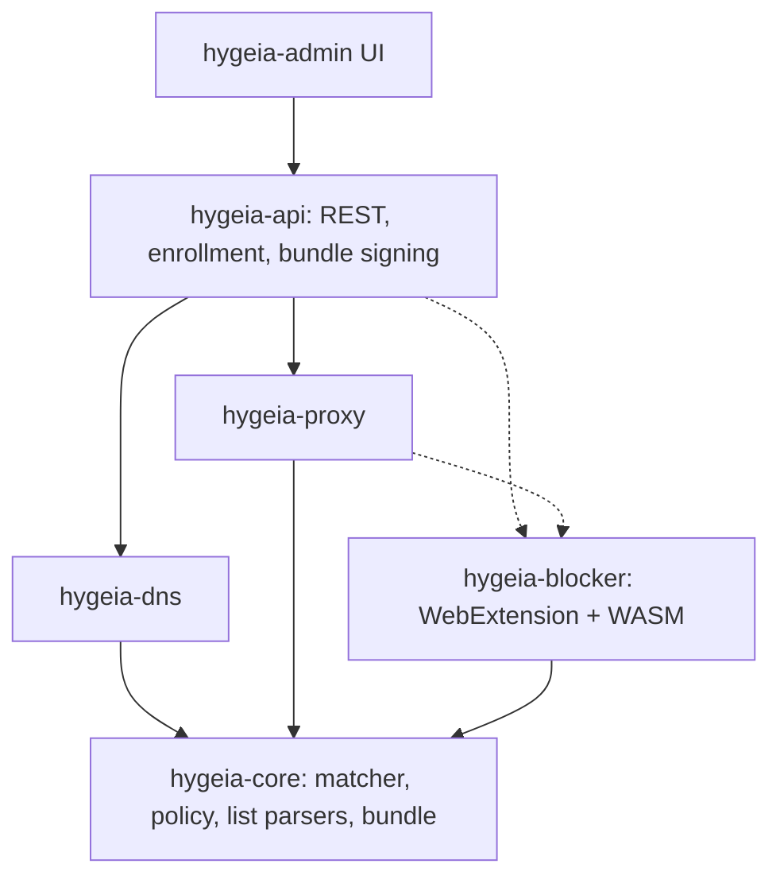

# Hygieia

Rust DNS and content filtering stack. Single-org or multi-tenant (single-org = multi-tenant with N=1, same code path), open-license blocklists, custom rules, audit and query logging, GDPR/NIS2 oriented. Self-hosted, container-first.



## Design principles

- `hygeia-core` is sync, I/O-free, runtime-free, so it compiles to WASM (CI checks `wasm32-unknown-unknown`).
- The API compiles lists + custom rules into one **versioned, ed25519-signed bundle**; DNS, proxy and blocker load the same artefact. Data planes are stateless and pull.
- Precedence: custom allow > custom block > list allow > list block > default.
- Credentials: `hyg_enr_` (short-lived, limited uses) is exchanged once for `hyg_dev_` (per device, revocable). Only SHA-256 hashes are stored; tenant/group come from the credential, never from client parameters.
- Audit: append-only SHA-256 hash chain, CEF export. Secrets never enter audit diffs.
- Lists are downloaded at runtime, never bundled in the code; each source carries license + attribution in bundle metadata. **Verify each list's license before enabling it.**
- TLS MITM (proxy) is opt-in at two levels: cargo feature `mitm` and config flag. Default tier: DNS + extension.

## Status

| Crate | State |
|---|---|
| `hygeia-core` | Done: trie matcher, hosts/domains/ABP(domain-level) parsers, policy, cosmetic model, signed bundle. Tested; builds for wasm32 |
| `hygeia-audit` | Done: hash chain, verify, CEF. Missing: syslog/OTLP sinks, external head anchoring |
| `hygeia-store` | In-memory store + PostgreSQL schema with RLS (`migrations/`). Missing: sqlx implementation |
| `hygeia-api` | Enroll, bundle (ETag/304), rules CRUD, simulate (dry-run), audit + verify. Static admin token. Missing: OIDC/RBAC, OpenAPI (utoipa), gRPC, list downloader/scheduler, groups/time windows, regex rules |
| `hygeia-dns` | UDP server, block via NXDOMAIN/null IP, plain UDP upstream. Missing: TCP, DoT/DoH/DoQ, DoT upstream, tenant resolution, query log, metrics |
| `hygeia-proxy` | Skeleton (CONNECT host decision) |
| `hygeia-blocker` | Skeleton (URL host check) |
| `web/` | Not started (planned: Next.js static export + Tailwind, served by the API) |

## Try it

```bash
HYGEIA_ADMIN_TOKEN=changeme cargo run -p hygeia
```

Defaults: API `127.0.0.1:8080`, DNS `127.0.0.1:5353` (UDP), upstream `9.9.9.9:53`. Optional `hygeia.toml` (every section optional):

```toml
[api]
listen = "0.0.0.0:8080"

[dns]
listen = "0.0.0.0:53"
upstream = ["192.168.1.1:53"]
block_mode = "nxdomain"   # or "null_ip"
```

Set `HYGEIA_SIGNING_KEY` (64 hex chars) for a stable bundle key; otherwise an ephemeral one is generated at start.

```bash
curl -XPOST localhost:8080/v1/admin/rules -H 'authorization: Bearer changeme' \
  -H 'content-type: application/json' -d '{"action":"block","pattern":"ads.example.com"}'
dig @127.0.0.1 -p 5353 x.ads.example.com   # NXDOMAIN after the next bundle refresh (<=5s)
```

## Develop

```bash
cargo test --workspace
cargo check -p hygeia-core --target wasm32-unknown-unknown
```
