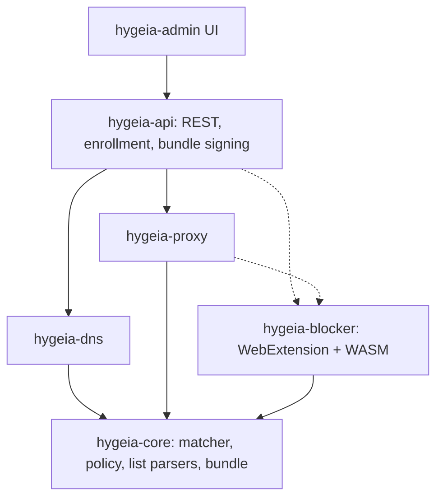

# Hygieia

Rust DNS and content filtering stack. Single-org or multi-tenant (single-org = multi-tenant with N=1, same code path), open-license blocklists, custom rules, audit and query logging, GDPR/NIS2 oriented. Self-hosted, container-first.



## Design principles

- `hygeia-core` is sync, I/O-free, runtime-free, so it compiles to WASM (CI checks `wasm32-unknown-unknown`).
- The API compiles lists + custom rules into one **versioned, ed25519-signed bundle**; DNS, proxy and blocker load the same artefact. Data planes are stateless and pull.
- Precedence: custom allow > custom block > list allow > list block > default.
- Credentials: `hyg_enr_` (short-lived, limited uses) is exchanged once for `hyg_dev_` (per device, revocable). Only SHA-256 hashes are stored; tenant/group come from the credential, never from client parameters.
- Audit: append-only SHA-256 hash chain, CEF export. Secrets never enter audit diffs.
- Lists are downloaded at runtime, never bundled in the code; each source carries license + attribution in bundle metadata. **Verify each list's license before enabling it.**
- TLS MITM (proxy) is opt-in at two levels: cargo feature `mitm` and config flag. Default tier: DNS + extension.

## Status

| Crate | State |
|---|---|
| `hygeia-core` | Done: trie matcher, hosts/domains/ABP(domain-level) parsers, policy, cosmetic model, signed bundle. Tested; builds for wasm32 |
| `hygeia-lists` | Catalogue (HaGeZi, StevenBlack, URLhaus, EasyList/EasyPrivacy, uBlock filters), https-only downloader with ETag/304 and size cap, parsing at refresh time, shrink/empty guards, per-source status. Missing: scheduler persistence, per-tenant source selection, AdGuard/other scriptlet dialects |
| `hygeia-audit` | Done: hash chain, verify, CEF. Missing: syslog/OTLP sinks, external head anchoring |
| `hygeia-store` | PostgreSQL (sqlx) is the production store: RLS tenant isolation, per-tenant audit chain, composite FKs. RBAC model (roles/permissions, `users`, `role_bindings`, `api_tokens` tables). In-memory store for tests. Missing: RBAC enforcement in the API (needs OIDC), list catalogue/subscription queries, sqlx offline cache |
| `hygeia-api` | Enroll, bundle (ETag/304), rules CRUD, simulate (dry-run), audit + verify. Static admin token. `/v1/admin/lists` (+`/refresh`). Missing: OIDC + RBAC wiring, OpenAPI (utoipa), gRPC, groups/time windows, regex rules |
| `hygeia-dns` | UDP server, block via NXDOMAIN/null IP, plain UDP upstream. Missing: TCP, DoT/DoH/DoQ, DoT upstream, tenant resolution, query log, metrics |
| `hygeia-proxy` | Skeleton (CONNECT host decision) |
| `hygeia-blocker` | Engine (signature check + rollback guard, URL/host verdicts, cosmetics, DNR plan) native + WASM; Chrome MV3 extension in `extension/` (enrollment, bundle sync, DNR, element hiding, scriptlets), e2e-tested in real Chromium. Missing: Firefox, procedural selectors, more scriptlets, per-tenant fail-closed — see `extension/README.md` |
| `web/` | Not started (planned: Next.js static export + Tailwind, served by the API) |

## Filter lists

Downloaded at runtime (never vendored), default every 12 h, bounded to 64 MiB per list, https only. Each source records license and attribution into the signed bundle. Select sources in `hygeia.toml`:

```toml
[lists]
refresh_hours = 12
sources = ["hagezi-pro", "easylist", "ublock-filters", "ublock-quick-fixes"]  # unset = catalogue defaults

[[lists.custom]]            # license + attribution are mandatory
id = "mine"
name = "My list"
url = "https://example.com/list.txt"
format = "domains"          # hosts | domains | abp
license = "CC0-1.0"
attribution = "me"
network = true              # feeds DNS / proxy
cosmetic = false            # feeds the blocker (element hiding + scriptlets)
```

Two kinds of rules, kept separate per source (`network` / `cosmetic`): domain rules (DNS, proxy) and DOM/JS rules (element hiding, `##+js(...)` scriptlet calls for the blocker). Lists are untrusted input:

- selectors are validated against CSS rule breakout (`}`, `;`, `@`, `url(`, unbalanced quotes/brackets) before they can reach a page;
- scriptlets are shipped as *data* (name + args); `trusted-*` scriptlets, which are privileged in uBlock Origin, are dropped by default;
- procedural selectors (`:has-text`, `:xpath`, ...), HTML filters (`##^`), `#?#`, `#$#`, AdGuard `#%#` and entity domains (`google.*`) are skipped and counted per source;
- a refresh that returns no usable rules, or shrinks below 50% of the previous count, is rejected and the previous copy is kept.

Footprint measured on HaGeZi PRO (240k domains): trie build ~0.2 s, +63 MB RSS, ~0.8 µs/lookup; signed bundle ~4.8 MB (uncompressed). `hagezi-tif` (1.7M domains) is off by default for that reason.

Licenses in the catalogue are GPL-3.0 (HaGeZi, uBlock filters), GPL-3.0-or-later OR CC-BY-SA-3.0 (EasyList family), MIT (StevenBlack), CC0 (URLhaus). Not bundling the lists avoids copyleft on this code, but **redistributing list-derived bundles to third parties is a separate question: verify before offering Hygieia as a service to other organisations.**

Live check against upstream: `cargo test -p hygeia-lists --test live -- --ignored --nocapture`.

## Try it

```bash
HYGEIA_ADMIN_TOKEN=changeme cargo run -p hygeia
```

Defaults: API `127.0.0.1:8080`, DNS `127.0.0.1:5353` (UDP), upstream `9.9.9.9:53`. Optional `hygeia.toml` (every section optional):

```toml
[api]
listen = "0.0.0.0:8080"

[dns]
listen = "0.0.0.0:53"
upstream = ["192.168.1.1:53"]
block_mode = "nxdomain"   # or "null_ip"
```

Persistence (PostgreSQL 17 baseline (schema needs 15+); without it the store is in-memory and non-persistent):

```bash
export HYGEIA_DATABASE_URL=postgres://hygeia_app:***@db/hygeia   # runtime role: non-owner, subject to RLS
export HYGEIA_MIGRATE_URL=postgres://hygeia_owner:***@db/hygeia  # schema owner: runs migrations at startup
```

Create the `hygeia_app` role **before** the first migration (grants are applied only if it exists). Tenant isolation: every tenant-scoped query runs in a transaction with `set_config('app.tenant', ..., true)`; RLS policies hide all other rows, and if the setting is missing no rows are visible. Device auth and enrollment happen before the tenant is known and go through `SECURITY DEFINER` functions. `audit_events` is append-only (trigger, also against the owner).

Known limitation: the bundle cache is per process, so with several API replicas each compiles its own bundle (different version/ETag). Persisting compiled bundles is on the roadmap.

Set `HYGEIA_SIGNING_KEY` (64 hex chars) for a stable bundle key; otherwise an ephemeral one is generated at start.

```bash
curl -XPOST localhost:8080/v1/admin/rules -H 'authorization: Bearer changeme' \
  -H 'content-type: application/json' -d '{"action":"block","pattern":"ads.example.com"}'
dig @127.0.0.1 -p 5353 x.ads.example.com   # NXDOMAIN after the next bundle refresh (<=5s)
```

## Develop

```bash
cargo test --workspace   # Postgres tests run if HYGEIA_TEST_PG_ADMIN and HYGEIA_TEST_PG_APP are set (see crates/hygeia-store/tests/pg.rs)
cargo check -p hygeia-core --target wasm32-unknown-unknown
```
