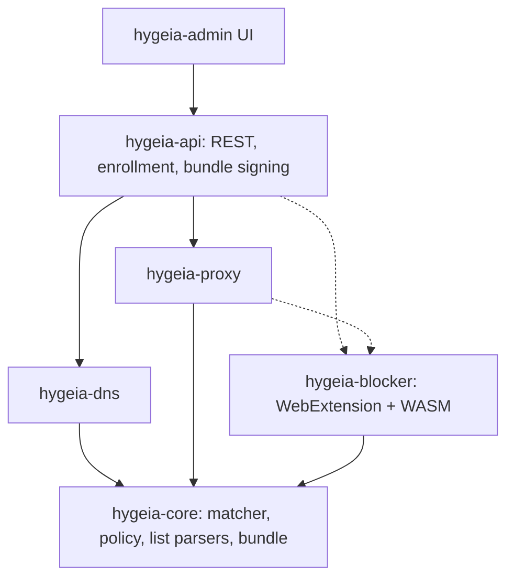

# Hygieia

Rust DNS and content filtering stack. Single-org or multi-tenant (single-org = multi-tenant with N=1, same code path), open-license blocklists, custom rules, audit and query logging, GDPR/NIS2 oriented. Self-hosted, container-first.



## Design principles

- `hygeia-core` is sync, I/O-free, runtime-free, so it compiles to WASM (CI checks `wasm32-unknown-unknown`).
- The API compiles lists + custom rules into one **versioned, ed25519-signed bundle**; DNS, proxy and blocker load the same artefact. Data planes are stateless and pull.
- Precedence: custom allow > custom block > list allow > list block > default.
- Credentials: `hyg_enr_` (short-lived, limited uses) is exchanged once for `hyg_dev_` (per device, revocable). Only SHA-256 hashes are stored; tenant/group come from the credential, never from client parameters.
- Audit: append-only SHA-256 hash chain, CEF export. Secrets never enter audit diffs.
- Lists are downloaded at runtime, never bundled in the code; each source carries license + attribution in bundle metadata. **Verify each list's license before enabling it.**
- TLS MITM (proxy) is opt-in at two levels: cargo feature `mitm` and config flag. Default tier: DNS + extension.

## Status

| Crate | State |
|---|---|
| `hygeia-core` | Done: trie matcher, hosts/domains/ABP(domain-level) parsers, policy, cosmetic model, signed bundle. Tested; builds for wasm32 |
| `hygeia-lists` | Catalogue (HaGeZi, StevenBlack, URLhaus, EasyList/EasyPrivacy, uBlock filters), https-only downloader with ETag/304 and size cap, parsing at refresh time, shrink/empty guards, per-source status. Missing: scheduler persistence, AdGuard/other scriptlet dialects |
| `hygeia-audit` | Done: hash chain, verify, CEF. Missing: syslog/OTLP sinks, external head anchoring |
| `hygeia-store` | PostgreSQL (sqlx) is the production store: RLS tenant isolation, per-tenant audit chain, composite FKs. tenants/groups, users, role bindings, API tokens. In-memory store for tests. Missing: sqlx offline cache |
| `hygeia-api` | Enroll, bundle (ETag/304), rules CRUD, simulate (dry-run), audit + verify. Static admin token. `/v1/admin/lists` (+`/refresh`). Missing: OIDC + RBAC wiring, OpenAPI (utoipa), gRPC, groups/time windows, regex rules |
| `hygeia-dns` | UDP server, block via NXDOMAIN/null IP, plain UDP upstream. Missing: TCP, DoT/DoH/DoQ, DoT upstream, tenant resolution, query log, metrics |
| `hygeia-proxy` | Skeleton (CONNECT host decision) |
| `hygeia-blocker` | Engine (signature check + rollback guard, URL/host verdicts, cosmetics, DNR plan) native + WASM; Chrome MV3 and Firefox MV3 extension in `extension/` (enrollment, bundle sync, DNR or webRequest blocking, element hiding, scriptlets); Chromium e2e-tested in a real browser, Firefox lint + fake-API tests only (not yet run in real Firefox). Missing: procedural selectors, more scriptlets, per-tenant fail-closed — see `extension/README.md` |
| `web/` | Admin UI: Next.js 16 static export + Tailwind, served by the API (no Node at runtime): overview, rules + what-if simulation, devices + one-time enrollment tokens, filter-list status/licenses, audit + chain verification, groups / role bindings / API tokens, tenants. Token and OIDC (authorization code + PKCE) login. Real-browser e2e against the real server and a mock IdP. Missing: OIDC refresh (session ends with the ID token), OpenAPI-generated client, i18n |

## Admin UI

```bash
(cd web && npm ci && npm run build)            # static export -> web/out
HYGEIA_ENVIRONMENT=dev HYGEIA_WEB_DIR=web/out cargo run -p hygeia   # UI at http://127.0.0.1:8080/
```

The binary serves the UI from `api.web_dir` / `HYGEIA_WEB_DIR` (the container image ships it in `/usr/share/hygeia/web`); API routes win over the UI fallback. `next dev` proxies `/v1` to `127.0.0.1:8080`.

- **Login**: API token / break-glass (pasted, validated against `/v1/me`), or single sign-on when `auth.oidc.client_id` is set. SSO is the authorization-code flow with PKCE S256, state and nonce; the UI sends the **ID token**, so `auth.oidc.audience` must equal the client id (or an audience your IdP puts in the ID token). The IdP must allow CORS on its token endpoint for the UI origin; add its origin to `auth.oidc.ui_connect_src` if it differs from the issuer's. There is no refresh: the session ends when the ID token expires.
- **Credential storage**: `sessionStorage` (per tab, never persisted). An XSS could read it, so the UI ships a strict **CSP without `unsafe-inline` scripts**: SHA-256 hashes of Next's inline bootstrap scripts are computed from the build at startup. Also `frame-ancestors 'none'`, `nosniff`, `no-referrer`; API data is rendered through React escaping only.
- **One-time secrets** (enrollment tokens, API tokens) are shown once and never stored by the UI.
- The UI hides what a role cannot do, but authorisation is enforced by the API; a 403 is shown as a message.

## Filter lists

Downloaded at runtime (never vendored), default every 12 h, bounded to 64 MiB per list, https only. Each source records license and attribution into the signed bundle. Select sources in `hygeia.toml`:

```toml
[lists]
refresh_hours = 12
sources = ["hagezi-pro", "easylist", "ublock-filters", "ublock-quick-fixes"]  # unset = catalogue defaults

[[lists.custom]]            # license + attribution are mandatory
id = "mine"
name = "My list"
url = "https://example.com/list.txt"
format = "domains"          # hosts | domains | abp
license = "CC0-1.0"
attribution = "me"
network = true              # feeds DNS / proxy
cosmetic = false            # feeds the blocker (element hiding + scriptlets)
```

**Per-tenant selection.** The platform config decides which sources are *available* (downloaded). Each tenant then has a policy: `all` (default: every available list) or `selected` (only its subscriptions, tenant-wide or per policy group; a group subscription never reaches other groups). Managed in the UI (*Filter lists*) or via `GET /v1/admin/list-subscriptions`, `PUT /v1/admin/list-policy`, `POST`/`DELETE /v1/admin/list-subscriptions` (needs the rules-write permission; every change is audited and takes effect on the next bundle pull). The catalogue with licenses is mirrored into PostgreSQL (`list_sources`); sources removed from the configuration are disabled, not deleted, so existing subscriptions survive. The built-in DNS server still serves only the default tenant (tenant resolution per DoH/DoT/CIDR is not implemented yet).

Two kinds of rules, kept separate per source (`network` / `cosmetic`): domain rules (DNS, proxy) and DOM/JS rules (element hiding, `##+js(...)` scriptlet calls for the blocker). Lists are untrusted input:

- selectors are validated against CSS rule breakout (`}`, `;`, `@`, `url(`, unbalanced quotes/brackets) before they can reach a page;
- scriptlets are shipped as *data* (name + args); `trusted-*` scriptlets, which are privileged in uBlock Origin, are dropped by default;
- procedural selectors (`:has-text`, `:xpath`, ...), HTML filters (`##^`), `#?#`, `#$#`, AdGuard `#%#` and entity domains (`google.*`) are skipped and counted per source;
- a refresh that returns no usable rules, or shrinks below 50% of the previous count, is rejected and the previous copy is kept.

Footprint measured on HaGeZi PRO (240k domains): trie build ~0.2 s, +63 MB RSS, ~0.8 µs/lookup; signed bundle ~4.8 MB (uncompressed). `hagezi-tif` (1.7M domains) is off by default for that reason.

Licenses in the catalogue are GPL-3.0 (HaGeZi, uBlock filters), GPL-3.0-or-later OR CC-BY-SA-3.0 (EasyList family), MIT (StevenBlack), CC0 (URLhaus). Not bundling the lists avoids copyleft on this code, but **redistributing list-derived bundles to third parties is a separate question: verify before offering Hygieia as a service to other organisations.**

Live check against upstream: `cargo test -p hygeia-lists --test live -- --ignored --nocapture`.

## Authentication

Admin API credentials (`Authorization: Bearer ...`), all authorised through roles (`owner` platform-wide, `admin`, `editor`, `viewer`, `auditor`; matrix in `crates/hygeia-store/src/rbac.rs`):

| Credential | Identity / scope | Use |
|---|---|---|
| OIDC JWT | `(iss, sub)` → roles from `role_bindings`, per tenant or platform-wide | humans (the admin UI runs the PKCE flow with the IdP and sends the token) |
| `hyg_api_...` | one tenant, one role, optional expiry, revocable | automation |
| break-glass | everything (owner-equivalent) | **staging/dev only**, see below |

Device credentials (`hyg_dev_...`) never open the admin API.

- A user created by a first OIDC login has **no roles** until bound. Identity is `(iss, sub)`: the e-mail claim is never used for authorisation. Algorithms are asymmetric only (RS*/ES*), issuer and audience are mandatory, `none`/HS* forgeries are rejected (tested).
- No privilege escalation: a principal can only grant roles whose permissions it holds in that scope; `owner` exists only platform-wide and a tenant-scoped "owner" gains no tenant-management rights.
- First owner in production: `auth.oidc.bootstrap_owners = ["<sub claim>"]` grants the platform `owner` role at startup (idempotent, additive).

### Break-glass (staging)

A single static credential for environments where OIDC is not available:

```toml
[auth]
environment = "staging"        # production (default) refuses to start with break-glass enabled
[auth.break_glass]
enabled = true
ttl_hours = 12                 # the credential dies this long after process start (0 = no limit)
```

```bash
export HYGEIA_BREAK_GLASS_TOKEN="$(openssl rand -hex 24)"   # >= 32 chars; secrets are never read from the file
```

Properties: refused when `environment = "production"` (also if `HYGEIA_ENVIRONMENT` tries to override it); secret length enforced; constant-time comparison on SHA-256 digests; 200 ms delay on failed authentication; **every request made with it is written to the audit chain of the affected tenant** (`auth.break_glass`, actor `break-glass`) and logged at WARN. It is a shared secret: restrict the listener at the network layer, rotate it after use, and prefer a time-limited process. `environment = "dev"` generates a throwaway token if none is given.

## Try it

```bash
HYGEIA_ENVIRONMENT=dev cargo run -p hygeia     # prints a throwaway break-glass token
```

Defaults: API `127.0.0.1:8080`, DNS `127.0.0.1:5353` (UDP), upstream `9.9.9.9:53`. Optional `hygeia.toml` (every section optional):

```toml
[api]
listen = "0.0.0.0:8080"

[dns]
listen = "0.0.0.0:53"
upstream = ["192.168.1.1:53"]
block_mode = "nxdomain"   # or "null_ip"
```

Persistence (PostgreSQL 17 baseline (schema needs 15+); without it the store is in-memory and non-persistent):

```bash
export HYGEIA_DATABASE_URL=postgres://hygeia_app:***@db/hygeia   # runtime role: non-owner, subject to RLS
export HYGEIA_MIGRATE_URL=postgres://hygeia_owner:***@db/hygeia  # schema owner: runs migrations at startup
```

Create the `hygeia_app` role **before** the first migration (grants are applied only if it exists). Tenant isolation: every tenant-scoped query runs in a transaction with `set_config('app.tenant', ..., true)`; RLS policies hide all other rows, and if the setting is missing no rows are visible. Device auth and enrollment happen before the tenant is known and go through `SECURITY DEFINER` functions. `audit_events` is append-only (trigger, also against the owner).

Known limitation: the bundle cache is per process, so with several API replicas each compiles its own bundle (different version/ETag). Persisting compiled bundles is on the roadmap.

Set `HYGEIA_SIGNING_KEY` (64 hex chars) for a stable bundle key; otherwise an ephemeral one is generated at start.

```bash
# TOKEN = the break-glass token printed at startup
curl -XPOST localhost:8080/v1/admin/rules -H "authorization: Bearer $TOKEN" \
  -H 'content-type: application/json' -d '{"action":"block","pattern":"ads.example.com"}'
dig @127.0.0.1 -p 5353 x.ads.example.com   # NXDOMAIN after the next bundle refresh (<=5s)
```

## Develop

```bash
cargo test --workspace   # Postgres tests run if HYGEIA_TEST_PG_ADMIN and HYGEIA_TEST_PG_APP are set (see crates/hygeia-store/tests/pg.rs)
cargo check -p hygeia-core --target wasm32-unknown-unknown
```
