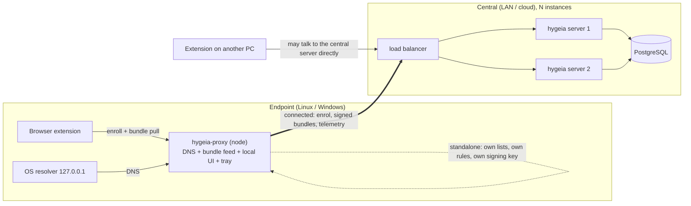

# Hygieia node (`hygeia-proxy`)

One installable binary for Linux and Windows. It is a **light local server** for a single machine or small site, and, when pointed at a central Hygieia server, an **endpoint/connector** for that server. The central server owns RBAC, configuration and audit; nodes enforce.

## Modes

| | `standalone` | `connected` |
|---|---|---|
| Control plane | embedded: local rules, lists, one implicit tenant | none locally: central server |
| Bundle signing key | node's own (generated at first run) | central's (the node never re-signs) |
| Lists | downloaded by the node | downloaded by the central server |
| Rules / RBAC / audit | local, single admin (the machine's owner) | central RBAC; node audit events are forwarded |
| Extension pins | node public key | central public key |
| If the other side is down | n/a | keeps enforcing the last verified bundle (cached on disk); fail-open policy for *configuration*, never for rules |

## Roles of the node

1. **Local DNS server** (UDP/TCP on 127.0.0.1 by default; DoT/DoH upstream). Standalone or connected, same engine as the central DNS.
2. **Extension connector.** The extension's server URL is the node. The node serves the same `/v1/enroll`, `/v1/bundle`, `/v1/pubkey` contract as the central server:
   - standalone: enrolment is local; bundles are signed by the node;
   - connected: enrolment is **relayed** to the central server (so every browser shows up as a device under central RBAC), bundles are fetched with the node's credential, **verified, cached and served unchanged** (central signature preserved, extension pins the central key).
3. **Local admin UI + tray icon** (graphical configuration): the existing Next.js admin UI served on `127.0.0.1`, plus a native tray icon (status, open dashboard, pause blocking 5/30/60 min). First-run wizard in the UI: pick mode, set upstream resolver, optionally enrol against a server.
4. *(later, optional)* HTTP(S) proxy / PAC and selective MITM (tier 3). Not needed for the extension flow.

## Credentials (connected mode)

New credential kind `hyg_node_…` (same pattern as `hyg_dev_…`: 256-bit secret, SHA-256 stored, prefix for secret scanners, per-node revocation): issued from an enrolment token with `kind = node`, scoped to tenant + the policy groups the node may serve. A node can only fetch bundles of its groups. Relayed browser enrolments carry `X-Hygeia-Node` so the server records which node vouched for the device.

## Central redundancy (several instances)

The server data plane is already stateless **except** the per-process bundle cache. Required before running replicas:

- compile bundles once, **persist them in PostgreSQL** keyed by (tenant, group, inputs-hash) with a stable ETag, under a Postgres advisory lock; every replica serves the stored bytes (same ETag/version everywhere);
- list refresh coordinated by an advisory lock (one downloader, others read the result);
- health/readiness endpoints for the load balancer; graceful shutdown;
- DNS (DoT/DoH/DoQ) with tenant resolution and query-log ingestion on the replicas.

## Local security constraints (decided up front)

- Local UI/API bind to loopback only, require a credential generated at install (file readable only by the owning user/service account) **and** validate the `Host`/`Origin` headers (DNS-rebinding and cross-site requests against a localhost admin port are a real attack).
- The node never exposes unauthenticated admin endpoints on LAN interfaces; serving other LAN clients as DNS is an explicit opt-in.
- Bundle signature is verified on every fetch; downgrade (lower version) refused, as in the extension.
- Changing the OS resolver is reversible and recorded; uninstall restores the previous settings.

## OS integration

| | Linux | Windows |
|---|---|---|
| Service | systemd unit (`DynamicUser` or dedicated user, `CAP_NET_BIND_SERVICE` for :53) | Windows service (`windows-service` crate), LocalService account |
| Port 53 | conflict with `systemd-resolved` stub: drop-in `DNSStubListener=no`, or serve on 127.0.0.1:5353 and point `resolved` at it | usually free; Windows DNS Client uses the adapter DNS setting |
| Point the OS at the node | `resolvectl dns <iface> 127.0.0.1` / NetworkManager | per-adapter DNS via the IP Helper / `netsh` equivalent |
| Package | `.deb`, `.rpm` (cargo-deb, cargo-generate-rpm), static musl tarball | MSI (WiX), Authenticode-signed |
| Tray | `tray-icon` (AppIndicator on GNOME needs the extension) | `tray-icon` |

**Resolver safety net:** if the node dies, a machine whose only resolver is 127.0.0.1 loses DNS. Mitigations: service supervision/restart, health-gated configuration (the node removes itself from the OS resolver list on clean shutdown), and an optional secondary resolver (documented trade-off: bypass).

## Assumptions made (change if wrong)

- The binary keeps the name `hygeia-proxy`; "proxy" in the user-facing sense. The crate `hygeia-proxy` becomes the node library; the HTTP proxy/PAC part is demoted to optional.
- "Graphical mode" = tray icon + local web UI (reuses the existing admin UI, same codebase on every OS), not a native widget toolkit.
- Standalone persistence = a file-backed store (atomic snapshot of the in-memory store, including the audit chain), not SQLite: the PostgreSQL schema relies on RLS and functions that do not port, and one machine does not need a database.
- macOS is out of scope for now.

## Verification limits

Development and CI here run on Linux. Windows code (service, tray, MSI, resolver changes) can be cross-compiled but **only a Windows runner can test it**: the plan adds a `windows-latest` CI job and a manual install checklist; nothing Windows-specific should be called "tested" before that exists.
