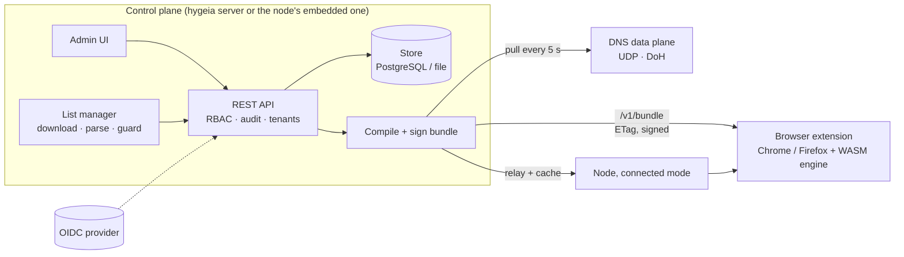

# Architecture overview

Hygieia is a filtering stack with one rule: **decide once, enforce everywhere**. A control plane compiles filter lists and custom rules into a single, versioned, ed25519-signed *bundle*. Every enforcement point (browser extension, DNS server, node) loads the same artefact through the same engine and applies the same precedence.

## Components

| Crate / dir | Role |
|---|---|
| `hygeia-core` | The engine. Synchronous, I/O-free, runtime-free so it also compiles to WASM. Domain trie on reversed labels, hosts/domains/ABP list parsers, cosmetic-rule model, policy precedence, signed bundle format. |
| `hygeia-audit` | Append-only SHA-256 hash chain, verification, CEF export. |
| `hygeia-store` | Persistence behind one `Store` trait: PostgreSQL (production, RLS), in-memory (tests), atomic JSON file (standalone node). The same conformance suite runs on all three. |
| `hygeia-lists` | Catalogue of open-license lists, https-only downloader (ETag, size cap), parsing and safety guards, per-source status. |
| `hygeia-api` | REST control plane: enrolment, bundles, rules, lists, devices, users/roles, API/DNS tokens, audit, simulate; OIDC/RBAC; static admin UI with CSP; DoH endpoint. |
| `hygeia-dns` | DNS decision function, UDP server, upstream forwarding. |
| `hygeia-runtime` | Shared runtime pieces: coordinated list refresher, DNS follower, key/secret files, config sections. |
| `hygeia` | The central server binary. |
| `hygeia-proxy` | The installable **node** (standalone or connected), CLI, Windows service entry. |
| `hygeia-winsvc` | Windows Service Control Manager glue (compiles on Windows only). |
| `hygeia-tray` | Tray icon (separate workspace; status and a dashboard shortcut). |
| `hygeia-blocker` | The engine exposed to JavaScript through WASM, plus the DNR plan for Chrome. |
| `extension/` | Chrome MV3 and Firefox MV3 extension. |
| `web/` | Admin UI: Next.js 16 static export + Tailwind 4. |

## The bundle

`"HYGB" | format | len | postcard payload | ed25519 signature`. Verify first, decode second; clients refuse an older version than the one they hold (rollback guard). The ETag is a hash of the bytes, so unchanged inputs mean an unchanged ETag. Precedence is fixed:

> custom allow **>** custom block **>** list allow **>** list block **>** default (allow)

Each source's license and attribution travel inside the bundle metadata. See [Data formats](../reference/data-formats.md).

## Tenancy and trust

- Single organisation = multi-tenant with one default tenant. Tenant and policy group are always derived from the **credential**, never from request parameters, on the data-plane endpoints.
- PostgreSQL enforces isolation with row-level security (`set_config('app.tenant', …, true)` per transaction; no setting means no rows) and composite foreign keys. Lookups that must happen before the tenant is known (device, API token and DNS token authentication, enrolment) go through narrow `SECURITY DEFINER` functions.
- Credential kinds: OIDC JWT (humans), `hyg_api_` (automation), break-glass (staging/dev), `hyg_enr_` → `hyg_dev_` (devices), `hyg_dns_` (cloud DNS), `hyg_own_` (the node's local owner). Only SHA-256 hashes are stored. See [API reference](../reference/api.md#credentials).

## Deployment shapes

| Shape | Pieces | Notes |
|---|---|---|
| **Standalone node** | `hygeia-proxy` | One PC. Own rules, own lists, own signing key, file-backed state. DNS off by default. |
| **Central server** | `hygeia` + PostgreSQL (+ OIDC) | Org-wide RBAC, config, audit. Several replicas behind a load balancer. |
| **Server + nodes** | both | Nodes relay enrolment and cache bundles; the server owns policy and audit. |
| **Cloud DNS (SaaS)** | `hygeia` with `[cloud_dns]` + TLS proxy | Per-token DoH. First slice implemented, see [Cloud DNS](../guides/cloud-dns.md). |

Details: [Node design](node.md) (modes, connected relay, packaging), [DNS service constraints](dns-service.md).

## Central redundancy

Replicas are stateless except for caches. They converge through PostgreSQL:

- **Compiled bundles** are stored by a content hash of their inputs (tenant, group, signing key, rules, list fingerprints); whoever compiles first publishes under an advisory lock, everyone serves the same bytes, same version, same ETag.
- **List refresh** is coordinated by a lease: one replica downloads and publishes the parsed lists; the others load them. A dead leader is replaced within three minutes.
- A replica re-checks the store at most every five seconds, so a rule added through one replica reaches the others within that window.
- `/healthz` (liveness) and `/readyz` (store reachable) for the load balancer; SIGTERM drains in-flight requests. All replicas must share `HYGEIA_SIGNING_KEY`.

## Data flows worth knowing

1. **Enrolment.** Admin creates a short-lived `hyg_enr_` token → the extension exchanges it once for a `hyg_dev_` credential bound to a tenant and policy group → the device pulls bundles with it.
2. **Rule change.** Admin saves a rule (audited) → the next bundle compile includes it (new version, new ETag) → extensions pick it up within 30 minutes (alarm) or on demand; the DNS follower within 5 seconds.
3. **List refresh.** The leader downloads (conditional GET), parses, applies guards (empty/shrunk results are rejected, previous copy kept), publishes the result; bundles are recompiled only if content changed.
4. **Offline.** Extension and node keep enforcing the last verified bundle (fail open for *configuration*, never for *rules*).
